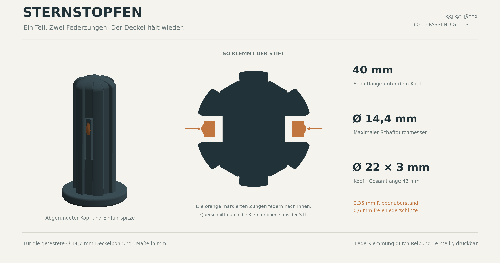
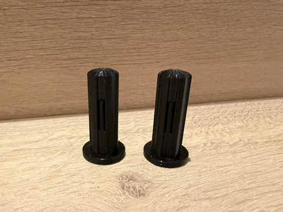
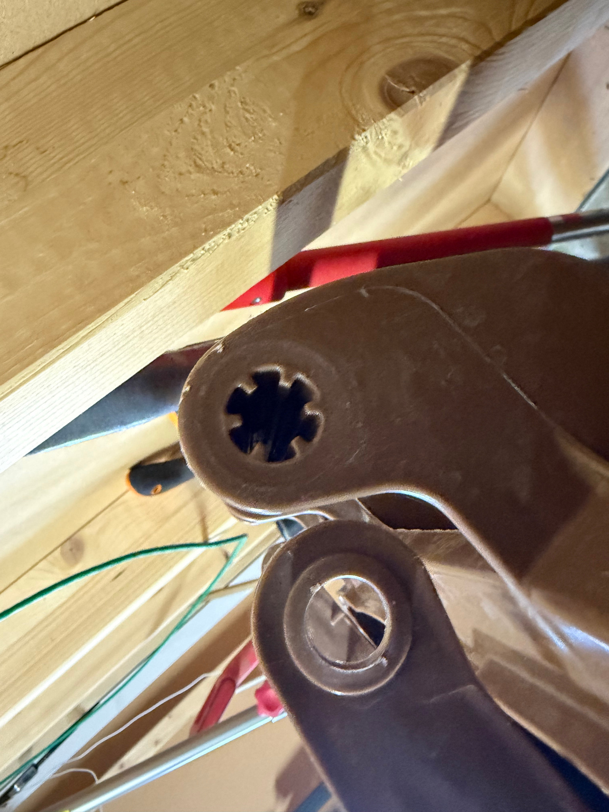

# Sternstopfen mit Federklemmung

Ein 3D-druckbarer **Ersatz-Scharnierbolzen für Mülltonnen mit sternförmiger Deckelaufnahme**. Zwei integrierte Federzungen mit gerundeten Klemmrippen halten den Stift im Scharnierkanal. Kopf und Spitze sind abgerundet; das Teil wird in einem Stück gedruckt.

**[↓ STL herunterladen](https://github.com/praschak/muelltonnen-sternstopfen/releases/latest/download/Sternstopfen_40mm.stl)** · [OpenSCAD-Quelle](modelle/Sternstopfen_40mm.scad)

## Passform

**Passend getestet an einer SSI-Schäfer-Mülltonne mit 60 Litern (EN 840-1).** Entscheidend sind die Maße und die Form der Aufnahme:

| Merkmal | Maß / Ausführung |
| --- | --- |
| Deckelbohrung am Testbehälter | rund, Ø 14,7 mm |
| Aufnahme an der Tonne | sechslappiger Stern; durchgehender Scharnierkanal |
| Schaft | 40 mm unter dem Kopf; maximal ca. Ø 14,4 mm |
| Kopf | Ø 22 mm, 3 mm dick |
| Gesamtlänge | 43 mm |

Vor dem Druck die eigene Aufnahme und Deckelbohrung vergleichen: Auch Tonnen derselben Marke können andere Scharniere haben. Die Dicke der Deckelöse ist in den 40 mm Schaftlänge enthalten.

*Sternaufnahme an der Tonne (oben) und runde Deckelbohrung (unten).*

## Drucken

Empfohlene Einstellungen:

| Einstellung | Empfehlung |
| --- | --- |
| Material | PETG |
| Schichthöhe | 0,20 mm |
| Wandlinien | 5–6 |
| Infill | 100 % |
| Ausrichtung | Kopf flach aufs Druckbett, Schaft nach oben |
| Stützstrukturen | aus; besonders die Federschlitze freihalten |
| Skalierung | 100 %, Einheit Millimeter |

Nach dem Abkühlen Fäden aus den **0,6-mm-Federschlitzen** entfernen und prüfen, dass beide Zungen leicht nach innen federn. Die STL liegt bereits in Druckausrichtung vor.

## Einsetzen

Deckelöse und Sternaufnahme ausrichten. Den Stift zuerst durch die runde Deckelbohrung führen, am Sternprofil ausrichten und von Hand bis zum Kopf eindrücken. Bei starker Gegenwehr Passform und Federschlitze prüfen. Die Klemmung ist lösbar; sie rastet nicht hinter einer Kante ein.

Die Passform wurde praktisch geprüft; ein Langzeittest steht noch aus. Eigenständiges Ersatzteilprojekt, kein Originalteil des Tonnenherstellers.
